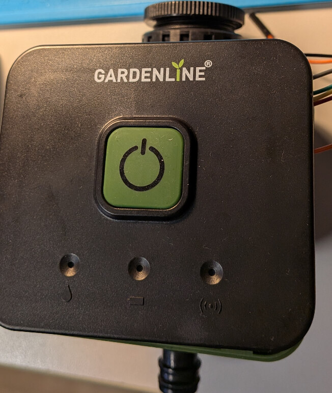

# Zigbee firmware for the GARDENLINE Bluetooth watering timer

Unofficial replacement firmware for the GARDENLINE Bluetooth watering timer sold by ALDI. It replaces the Bluetooth firmware on the BT3L module with a Zigbee end device. The FT61E0A5 on the main board continues to operate the valve, handle the button, and stop watering when the timer expires.



| Hardware and software | Tested configuration |
| --- | --- |
| Radio module | BT3L with Telink TLSR8250F512ET32 |
| Valve controller | FT61E0A5 |
| Original app | ALDI GARDEN |
| Original BLE product ID | `16wgjvck` |
| Zigbee model ID | `GARDEN-BT3L-Z` |

Check the module and controller markings before flashing. GARDENLINE branding alone does not identify the board revision.

## Features and test status

- Zigbee on/off control and battery reporting. A plain **ON** starts a 60-second run.
- The Zigbee2MQTT converter accepts timed runs from **1 to 21,600 seconds**. This range was tested in the firmware and converter. The valve controller's actual behavior at the six-hour limit still needs a hardware test.
- The firmware reports valve state after the valve controller confirms it. The physical button continues to control the valve locally.
- v0.3 adds suspend and a three-second Zigbee poll interval. The firmware enables suspend after it has validated a wake signal from the valve controller against a UART frame. A Zigbee command can take a few seconds to arrive. The original unit measured about **250 µA** at idle. Current draw and wake behavior with v0.3 still need a hardware measurement.

The first Zigbee build was tested on the valve. The v0.3 cross-build and host-side logic have been checked. Test the flashed device with the water supply disconnected before using it for irrigation.

## Back up, flash, and pair

1. Disconnect the water supply. Identify the SWire pads from the [hardware guide](docs/hardware.md).
2. Read the entire **512 KiB** flash from address `0x000000` and keep the dump from your own unit. Check that two independent reads match byte for byte and that the Telink image has the `KNLT` marker at offset `0x08`. A file of the expected size can still contain read errors.
3. Download [BT3L-Zigbee-v0.3.bin](firmware/BT3L-Zigbee-v0.3.bin) and check its [SHA-256 checksum](firmware/SHA256SUMS). Program the raw image at `0x000000` with sector erase limited to the image and verify the result. A whole-chip erase would also remove the original device data, including the sectors at `0x76000` and `0x77000`.
4. Disconnect the programmer and power-cycle the device. On a fresh installation, enable joining in Zigbee2MQTT and hold the valve's physical button to request pairing. On an update, use the existing pairing if it is still present.
5. Test start, stop, the automatic timeout, and the physical button. To restore Bluetooth, program and verify your own full original flash dump at `0x000000`.

## Zigbee2MQTT

Install [garden-bt3l-z.mjs](zigbee2mqtt/garden-bt3l-z.mjs) as an external converter. In the Zigbee2MQTT frontend, open **Settings → Dev console → External converters**. You can also install the file in the `external_converters` directory under the Zigbee2MQTT data directory and restart Zigbee2MQTT. Reconfigure the device if it was already interviewed. See the [Zigbee2MQTT external converter documentation](https://www.zigbee2mqtt.io/advanced/more/external_converters.html).

Publish with **retain off** to `zigbee2mqtt/<friendly_name>/set`.

| MQTT payload | Action |
| --- | --- |
| `{"state":"ON"}` | Start a 60-second run |
| `{"water_for":600}` | Start a ten-minute run |
| `{"state":"ON","on_time":600,"off_wait_time":0}` | Start a ten-minute run using the timed on syntax |
| `{"state":"OFF"}` | Stop watering |

The converter uses a 32-bit seconds field on custom Zigbee cluster `0xFC90` for timed watering. The firmware also exposes standard Zigbee On/Off and Power Configuration clusters. The custom duration field is documented here for Zigbee2MQTT.

## Build from source

Requires Linux with Git, GNU Make, Python 3, tar with bzip2 support, and unzip. The [pinned ZigbeeTLc revision](https://github.com/pvvx/ZigbeeTLc/tree/c249d8a7caddb5012d06aba580d4a53d1957f9c1) contains the Telink SDK archives and TC32 toolchain.

```sh
git clone https://github.com/seeers/garden-bt3l-zigbee.git
cd garden-bt3l-zigbee
git clone https://github.com/pvvx/ZigbeeTLc.git ZigbeeTLc
git -C ZigbeeTLc checkout c249d8a7caddb5012d06aba580d4a53d1957f9c1
git -C ZigbeeTLc apply ../upstream-makefile.patch
cp -R valve ZigbeeTLc/
make -C ZigbeeTLc -f valve/build.mk install
make -C ZigbeeTLc -f valve/build.mk -j4
```

The output is `ZigbeeTLc/out-valve/BT3L-Valve-Zigbee.bin`.

## Hardware and diagnostics

- [Pinout, programming, and idle current measurement](docs/hardware.md)
- [UART protocol and browser tools](docs/uart.md)

## Acknowledgements

- Thanks to [atc1441](https://github.com/atc1441) for [ATC_MiThermometer](https://github.com/atc1441/ATC_MiThermometer). Seeing custom firmware bring new capabilities to a Telink-based thermometer inspired this project and the idea of bringing Zigbee to a watering timer.
- Thanks to [pvvx](https://github.com/pvvx) and the [ZigbeeTLc contributors](https://github.com/pvvx/ZigbeeTLc) for the Zigbee firmware foundation, Telink build setup, and TLSR825x support used here.
- Thanks to Telink Semiconductor for the Zigbee SDK. The [third-party notices](licenses/README.md) identify the upstream license files.
