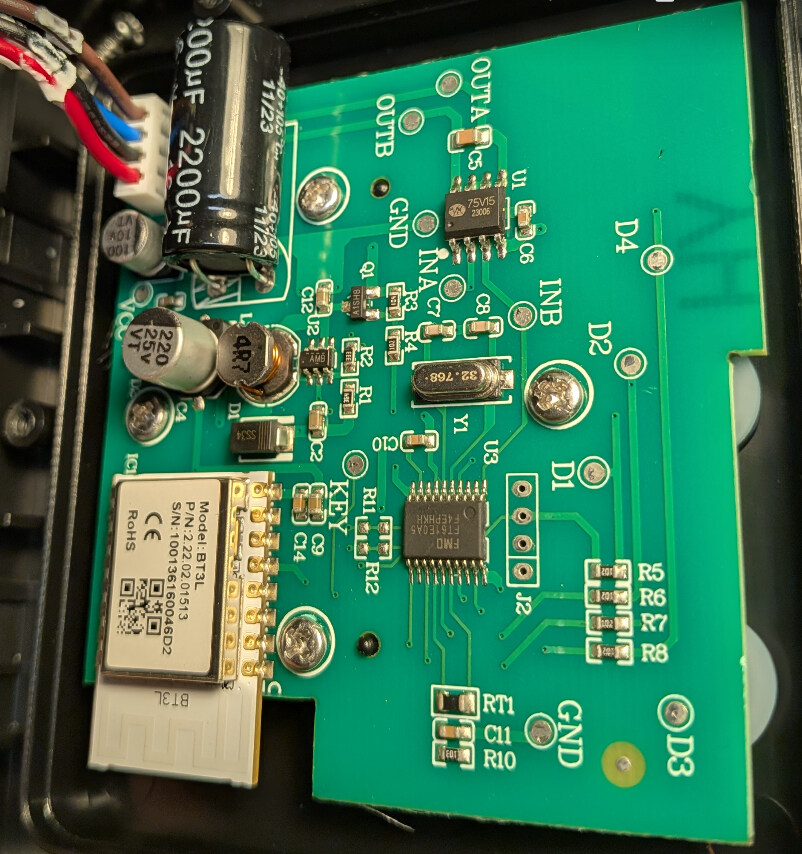
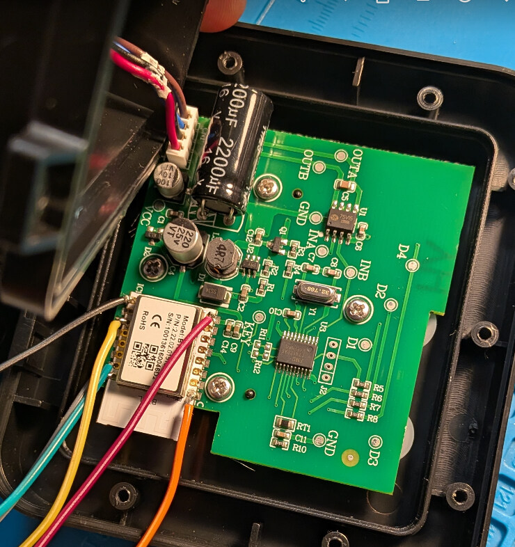

# BT3L hardware guide

The table is a **top view looking at the module on the component side of the board, with the printed antenna pointing down**. Rows run from the top edge toward the antenna. Verify ground and supply with a meter before attaching a programmer. All signal names are relative to the BT3L.

| Left pin | Left function | Right pin | Right function |
| ---: | --- | ---: | --- |
| 9 | GND | 8 | 3.3 V |
| 10 | PC0 | 7 | PC2 |
| 11 | SWS / SWire | 6 | PC3 |
| 12 | PA0 | 5 | PD2, wake FT61E0A5 |
| 13 | PB4 | 4 | PD7 |
| 14 | PB5, wake BT3L | 3 | Unlabelled in module drawing |
| 15 | PB7, UART RX | 2 | PC4 |
| 16 | PB1, UART TX | 1 | RST |

## Board photos

The main board with the BT3L radio module at lower left and the FT61E0A5 valve controller to its right. The BT3L antenna points down, matching the orientation of the pin table.

The same board during bench testing, with temporary leads soldered to the module. Use the pin table above to identify connections.

## SWire programming

We successfully wrote the Zigbee firmware to the BT3L over SWire using [MostEmpire's Telink Open Source Debugger](https://github.com/MostEmpire/telink-opensource-debugger) with a Blue Pill (STM32F103). Use a 3.3 V-compatible programmer with common ground and connect its SWire line to pin 11. Follow the programmer's documentation for its reset and supply connections. Supply the board through one source at a time. Pin 8 is the module's 3.3 V rail. The SWire programmer's bridge firmware and host utility are separate from this project.

## Power measurement

See the [v0.6 PPK2 idle trace](power-measurement.md).

With the water supply disconnected, unplug the programmer and UART adapters, then power-cycle the paired timer. Open and close the valve with the physical button once so the firmware can observe a UART frame preceded by a valid wake signal. Check that Zigbee reports both state changes and then test a remote start and stop.

Measure the average current of the **whole unit** with the valve closed over at least 30 seconds. The Zigbee radio wakes periodically to poll. If the module stays awake, check **PB5 (pin 14)**. It should idle low and go high before the FT61E0A5 transmits a UART message. **PD2 (pin 5)** carries the wake signal in the other direction.
