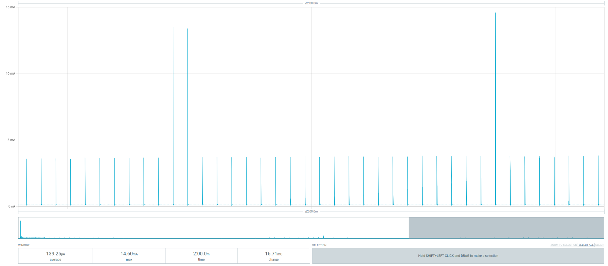

# v0.6 idle current measurement

Measured on the GARDENLINE watering timer running v0.6 with a Nordic PPK2 in Source Meter mode. The values below describe the selected two-minute window.

| Item | Value |
| --- | ---: |
| PPK2 supply setting | 2.979 V |
| Sampling rate | 100,000 samples/s |
| Window | 120 s |
| Average current | **139.25 µA** |
| Peak current | 14.60 mA |
| Charge over the window | 16.71 mC |

The regular spikes are about three seconds apart, consistent with the configured Zigbee parent poll interval. The trace alone cannot identify the cause of individual larger peaks. Zigbee application reports use separate intervals and may be much less frequent.

The original firmware had previously been measured at about **250 µA** at idle. The v0.6 reading is about **44% lower** than that earlier value. The conditions of the earlier measurement were not documented alongside this trace, so the percentage is an approximate comparison. This window covers idle current and does not include normal watering cycles or valve switching.
